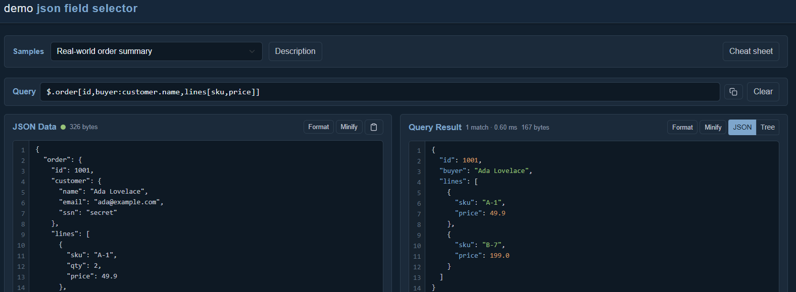

<div align="center">
  
</div>

# Json

A .NET library for parsing JSON into a navigable tree and extracting fields via a JSONPath-like query syntax.

[Try the interactive playground at dotnetlab.se](https://www.dotnetlab.se).

## JsonTree

Parses a JSON string into an in-memory tree where each node has a full JSONPath (e.g. `$.person.name`, `$['first name']`).

```csharp
var tree = JsonTree.Parse("""{"person":{"name":"Alice","age":30}}""");

var node = tree.FindNode("$.person.name");
// node.Value    → "Alice"
// node.Kind     → JsonValueKind.String
// node.JsonPath → "$.person.name"

var nodes = tree.Flatten();        // all nodes as a flat array
var json  = tree.ToJsonString();   // round-trip back to JSON
```

You can also build a tree programmatically:

```csharp
var tree = JsonTree.Create()
    .AddObject("person", person => person
        .Add("Name", "Molly")
        .Add("Age", 30)
        .AddObject("Address", address => address
            .Add("Country", "Sweden"))
        .AddArray("Tags", tags => tags
            .Add("friend")
            .Add("vip")
            .AddNull()));

var json = tree.ToJsonString();
// {"person":{"Name":"Molly","Age":30,"Address":{"Country":"Sweden"},"Tags":["friend","vip",null]}}
```

For a root array, use `CreateArray`:

```csharp
var tree = JsonTree.CreateArray()
    .Add(items => items
        .Add("Molly")
        .Add(30)
        .AddObject(person => person.Add("Country", "Sweden")));

var json = tree.ToJsonString();
// ["Molly",30,{"Country":"Sweden"}]
```

Node JsonPaths use dot notation for object properties and bracket notation for array indices and non-identifier keys:

```
$.person          →  regular object property
$.matrix[0][1]    →  array indices
$['first name']   →  key that is not a valid identifier
```

`FindNode` accepts a JSONPath and returns the matching node, or `null` if not found. Lookup prefers an exact property name and falls back to the first case-insensitive match at each level. Repeated identical property names resolve to the first occurrence.

Object, array, and scalar roots all round-trip through `ToJsonString()`. Numbers that cannot be represented exactly by `long`, `decimal`, or `double` use a `JsonNumber` value; its `Text` property preserves the original number without rounding, including very large or small exponents.

`JsonNumber` also accepts manually supplied numeric text and validates that it contains a JSON number. Its `Text` property is immutable. The tree text view includes scalar and empty roots, such as `$ = 42` and `$ = []`.

## JsonFieldSelector

Extracts and projects fields from a JSON document. Supports named properties, wildcards, and array indices.

```csharp
var selector = new JsonFieldSelector(jsonString);
var result   = selector.Select("$.person.name");
```

### Supported syntax

| Expression | Returns |
|---|---|
| `$` | Entire document |
| `$.a.b` | Scalar value or sub-object at path |
| `$['first name']` | Property with spaces or other special characters; double quotes and escaped characters are also supported |
| `$.items[*].name` | Array of `name` values from every element |
| `$.items[*].category\|distinct` | Distinct category values, preserving first occurrence order |
| `$.items.*` | Array of all property values of an object |
| `$..name` | Recursive descent — array of every `name` property at any depth (nodelist) |
| `$..events[number,name]` | Recursive descent with a trailing projection applied to each matched node |
| `$..books[*][title,price]` | Projection over recursive descent — flattens every matched array and projects each element |
| `$..*` | Recursive wildcard — every node (property value and array element) at any depth |
| `$.store..*` | Recursive wildcard scoped to a branch |
| `$..[*]` | Every array element at any depth |
| `$..[0]` | The first element of every array at any depth |
| `$..[-1]` | The last element of every array at any depth |
| `$.store..price` | Recursive descent in the middle of a path — only `price` under `store` |
| `$..orders..price` | Multiple recursive descents in one expression |
| `$..[cost:price]` | Recursive descent with alias — every `price` at any depth, renamed to `cost` |
| `$.a[*].b[*].c` | Chained wildcards across nested arrays |
| `$.person[name,age]` | Object projected to the listed fields only |
| `$[name,age]` | Projection from the root object |
| `$.items[*][id,name]` | Array of projected objects |
| `$.items[id,name]` | Same as above — `[*]` is inferred when the target is an array |
| `$.order[id,customer[name,email]]` | Nested sub-projection inside an object |
| `$[id,user[name,posts[title,date]]]` | Sub-projection at any depth, including arrays nested inside objects |
| `$.events[description,league.name]` | Dotted path inside a projection — descends into nested objects |
| `$.events[description,league:league.name]` | Renames the projected field — emits as `"league"` instead of `"name"` |
| `$.participants[0]` | Specific array element by index |
| `$.participants[-1]` | Negative index — counted from the end (`-1` is the last element) |
| `$.matrix[1][0]` | Chained indices in nested arrays |
| `$[home:participants[0].name]` | Indexed access inside a projection field, typically combined with an alias |
| `$[items[0]]` | Indexed value projected under the array's property name, such as `{"items":10}` |

Projections compose to arbitrary depth: each inner field may itself be plain, `field[*]`, `field[*][...]`, or `field[...]`. When the resolved node is an array, `field[...]` is treated as a per-element projection, so the explicit `[*]` is optional.

Any field inside a projection can be aliased with `alias:path` — the source path resolves normally and the emitted property name becomes `alias`. The alias may be combined with sub-projections, e.g. `info:person[name,age]` emits `{"info":{...}}`.

Field names in projections and path segments prefer an **exact match**, then fall back to the first **case-insensitive** match. Quoted names can also appear in projections, for example `$['first name',age]` or `$[name:'first name']`. Whitespace inside quotes is preserved.

Whitespace is allowed between query tokens, but cannot split an unquoted property name, array index, or operator.

Wildcards always return arrays, including zero or one match. Array-valued matches remain nested: `$.*` applied to `{"items":[1,2]}` returns `[[1,2]]`. Array indices and `[*]` apply only to arrays.

The recursive descent selector `$..name` visits every node in the document (pre-order / descendant order) and collects all properties matching `name` at any depth. Matching is **case-insensitive** and includes every matching property, and the result is **always a JSON array** (RFC 9535 nodelist semantics) — even for zero matches (`[]`) or a single match (`[value]`). A trailing projection such as `$..events[number,name]` is applied to each recursively matched node.

The recursive descent family extends beyond named properties:

- `$..*` collects **every** node (each property value and array element) at any depth; combine it with a leading path such as `$.store..*` to scope the descent to a branch.
- `$..[*]` collects **every array element** at any depth, while `$..[0]` / `$..[-1]` pick a specific (optionally negative) index from each array found at any depth.
- Recursive descent does not have to be the first step — `$.store..price` descends only under `store`, and multiple descents can be chained, e.g. `$..orders..price`.
- A recursive descent can be aliased with bracket syntax — `$..[cost:price]` collects every `price` at any depth and renames each match, emitting `[{"cost":100},{"cost":20},...]`. The matched value keeps its original shape (objects and arrays are preserved verbatim under the alias).

All recursive-descent results follow the same nodelist semantics — they are always a JSON array.

Append `|distinct` to remove duplicate values from a selector result. Distinct is applied after any projection, preserves the order of the first occurrence and works with scalar values as well as arrays and objects. Numbers are compared by numeric value, arrays are order-sensitive, and objects are compared structurally regardless of property order. JSON types remain distinct, so `1`, `"1"` and `true` are different values.

The selector filters duplicates while processing the matched nodes and retains only the set of values already seen; it does not serialize a second complete result before deduplication.

Distinct compares exact numeric values and works with both implicit and explicit array projections: `$.items[id]|distinct` and `$.items[*][id]|distinct` produce the same result.

If a projection references a field that does not exist in the data (e.g. `$.person[Qname]`, or a field that is omitted because its value is `null`), that field is simply skipped in the output rather than causing an error. This keeps projections robust when working with optional/nullable fields that may be absent from the serialized JSON.

### Examples

```csharp
// Wildcard — returns ["Allan","Bertil"]
selector.Select("$.crew.members[*].name");

// Projection — returns {"name":"Alice","age":30}
selector.Select("$.person[name,age]");

// Nested wildcard + projection — returns [{...},{...}]
selector.Select("$.store.book[*][title,price]");

// Array auto-detect — same result as $.crew[*][id,name]
selector.Select("$.crew[id,name]");

// Sub-projection nested inside another sub-projection
selector.Select("$[requestId,draw[drawComment,events[eventNumber,description]]]");

// Aliasing — emits {"members":[{"id":1,"name":"Allan"},...]}
selector.Select("$[members:crew[id,name]]");

// Indexed access with aliases — emits {"home":"KHK","away":"FBK"}
selector.Select("$[home:participants[0].name,away:participants[1].name]");

// Negative index — emits the last participant's name
selector.Select("$.participants[-1].name");

// Recursive descent — every price at any depth, e.g. [100,20,5,200]
selector.Select("$..price");

// Recursive descent with projection — projects each matched node
selector.Select("$..events[number,name]");

// Projection over recursive descent — collects every "books" array at any depth,
// expands each element with [*] and projects it, e.g. [{"title":"A","price":100},...]
selector.Select("$..books[*][title,price]");

// Recursive wildcard — every node at any depth
selector.Select("$..*");

// Every array element at any depth, e.g. [1,2,3,4,5]
selector.Select("$..[*]");

// First / last element of every array at any depth
selector.Select("$..[0]");
selector.Select("$..[-1]");

// Recursive descent in the middle of a path — only prices under "store"
selector.Select("$.store..price");

// Multiple recursive descents in one expression
selector.Select("$..orders..price");

// Recursive descent with alias — every price at any depth renamed to "cost",
// e.g. [{"cost":100},{"cost":20}]
selector.Select("$..[cost:price]");

// Distinct scalar values — preserves the first occurrence order
selector.Select("$.products[*].category|distinct");

// Distinct values gathered recursively from any depth
selector.Select("$..country|distinct");

// Distinct is applied after projection
selector.Select("$.orders[*][status]|distinct");
```

### Working directly with UTF-8 bytes or streams

`JsonFieldSelector` and `JsonTree` can be fed UTF-8 JSON directly, avoiding an intermediate `string` allocation. The selector can also write its projection straight into an `IBufferWriter<byte>`:

```csharp
ReadOnlyMemory<byte> utf8Json = ...;

// Parse straight from bytes (also works with a Stream)
var tree = JsonTree.Parse(utf8Json);

// Project straight into a byte buffer
var output = new ArrayBufferWriter<byte>();
new JsonFieldSelector(utf8Json).Select("$.person[name]", output);
// output.WrittenSpan now holds the UTF-8 result
```

The classic `string`-based API is unchanged and produces identical results.

## WebApi

`WebApi` is a small [FastEndpoints](https://fast-endpoints.com/) service that exposes the selector over HTTP.

```
GET /items
```

Returns a JSON object of the form `{ "itemCount": <int>, "items": [ ... ] }`. Items are generated lazily on demand, so pass an optional `limit` query parameter to cap the number of returned items (defaults to 1000 when omitted):

```
GET /items?limit=10
```

`limit` must be between 0 and 10,000 inclusive. Values outside this range return HTTP 400; omitting it still returns 1,000 items.

Send an `X-Selector` header to project the response server-side:

```
GET /items
X-Selector: $.items[name,price]
```

```json
[{"name":"Keyboard","price":89.99},{"name":"Mouse","price":49.50},...]
```

Without the header the full payload is returned. The projection is applied by `SelectorMiddleware`, which buffers the response, parses it directly from the buffered UTF-8 bytes and writes the projected result back. If the `X-Selector` value has invalid syntax the middleware lets the exception propagate to the global exception handler (`UseDefaultExceptionHandler`) instead of silently returning the full response.

Projection applies only to successful, non-empty JSON responses (`application/json` or an `application/*+json` media type). HTTP error responses, HEAD requests, empty bodies, and other content types pass through unchanged so that selectors do not hide error details.

`Item` has several optional (nullable) properties (`Description`, `Price`, `Quantity`, `InStock`, `CreatedAt`). The serializer is configured with `DefaultIgnoreCondition = JsonIgnoreCondition.WhenWritingNull`, so any property that is `null` is omitted from the response entirely rather than emitted as `"field":null`.

## Demo

`Demo` is a standalone Blazor WebAssembly client that provides an interactive playground for the selector. It runs entirely in the browser and shares the selector logic by referencing the `Json` library directly.

Use the hosted playground at [www.dotnetlab.se](https://www.dotnetlab.se).

<a href="docs/demo-preview.png"></a>

Run it locally with:

```
dotnet run --project Demo
```

Features:

- **Live evaluation** — paste JSON, type a query, and the result updates automatically as either field changes (no "Run" button).
- **Debounced editing** — JSON and query edits wait briefly for typing to pause. Parsed input is reused when only the query changes, and rendering reuses the parsed result.
- **Built-in examples** — a dropdown of progressively complex examples that demonstrate every `JsonFieldSelector` feature listed in the syntax table above, filling in both the JSON and the query.
- **Distinct examples** — explore unique scalar values, recursive matches and projected objects using `|distinct`.
- **Result views** — toggle the output between syntax-highlighted JSON and the `JsonTree` text representation.
- **JsonTree-powered highlighting** — the output is colorized by walking the parsed `JsonTree`/`Node` model rather than regex tokenizing.
- **Hover & click paths** — hover a key/value in the output to see its JSONPath, or click it to set that path as the query.
- **Clipboard helpers** — copy the current query and paste JSON straight into the input.
- **Editor conveniences** — line-number gutters, Format/Prettify and Minify buttons, a live JSON validity indicator, a result counter with timing (`X matches · Y ms`), and a collapsible cheat sheet of the full syntax.
